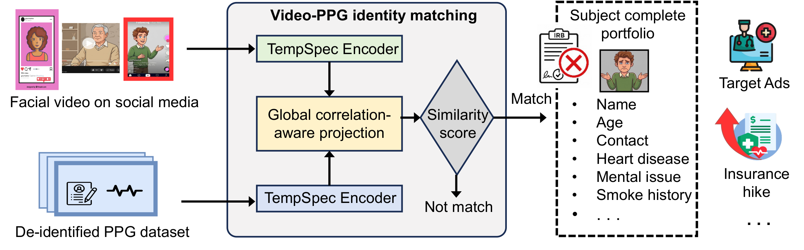

# PPG is Not Anonymous: Linking De-identified PPG Datasets to Individuals via Pervasive Video

<p align="center">
  
</p>

<p align="center">
  <a href="https://doi.org/10.1145/3857989"></a>
  <a href="https://doi.org/10.1145/3857989"></a>
  
  
</p>

Official implementation of **ViPLink** (IMWUT 2026).
**Paper: https://doi.org/10.1145/3857989**

ViPLink links a facial video to a de-identified contact-PPG recording of the same person. A dual-branch
temporal–spectral encoder embeds 45 s windows of each modality into a shared identity space, and a multi-scale CCA
aligns the two modalities. On MCD-rPPG (600 subjects) it reaches 18.33% EER / 0.8755 AUC.

## Install

```bash
git clone https://github.com/SKN000/ViPLink.git
cd ViPLink
pip install -r requirements.txt
```

## Data format

- **Video**: per-frame RGB face crops saved as `<sid>_<camera>_<session>.npy` with shape `(T, H, W, 3)`, 30 fps.
- **PPG**: text file `<sid>_<camera>_<session>.txt`, first column = raw cPPG at 30 Hz.
- `session` is `before` or `after`. Paths are set in `configs/mcd_rppg.yaml`.

## Usage

**1. Face crops → video traces** `(3, T)`:

```bash
python scripts/extract_video_traces.py --input_dir faces/ --output_dir data/mcd_rppg/video_traces
```

**2. Match videos against PPG recordings** (pretrained weights included, each recording ≥ 45 s):

```bash
python scripts/inference.py --weights weights/viplink_mcd.pt --cca weights/viplink_mcd_cca.npz \
    --video a.npy b.npy --ppg x.txt y.txt --out scores.csv
```

Prints a `(n_video, n_ppg)` similarity matrix; higher = more likely the same person.

**3. Train** (one subject-independent fold) and refit the CCA:

```bash
python scripts/train.py --config configs/mcd_rppg.yaml --fold 0
python scripts/fit_cca.py --config configs/mcd_rppg.yaml --fold 0 \
    --weights runs/viplink_mcd_fold0/viplink.pt --out runs/viplink_mcd_fold0/cca.npz
```

Python API:

```python
from viplink import ViPLink, MultiScaleCCA, encode_video, encode_ppg
model = ViPLink.from_pretrained('weights/viplink_mcd.pt')
cca = MultiScaleCCA.load('weights/viplink_mcd_cca.npz')
e_v = encode_video(model, video_traces)   # (3, T) -> (256,)
e_p = encode_ppg(model, ppg)              # (T,)   -> (256,)
score = cca.similarity(e_v[None], e_p[None])[0, 0]
```

## Citation

```bibtex
@article{shen2026ppg,
  author    = {Shen, Kunning and Xu, Chenhan and Li, Huining},
  title     = {{PPG} is Not Anonymous: Linking De-identified {PPG} Datasets to Individuals via Pervasive Video},
  journal   = {Proceedings of the ACM on Interactive, Mobile, Wearable and Ubiquitous Technologies},
  year      = {2026},
  volume    = {10},
  number    = {4},
  articleno = {251},
  doi       = {10.1145/3857989}
}
```
